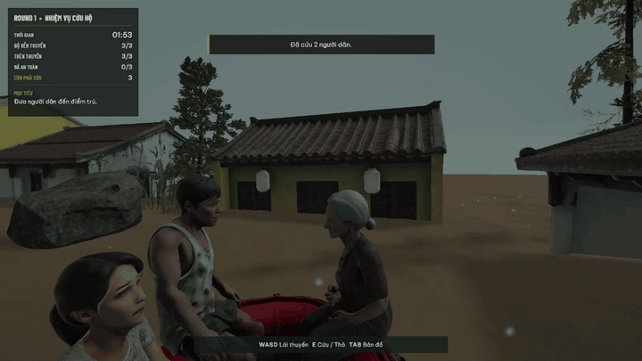
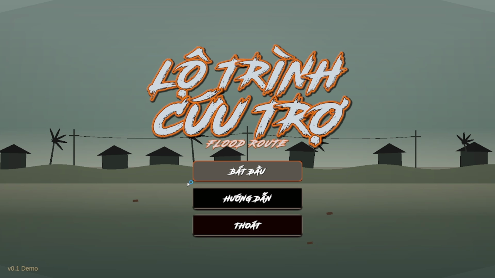
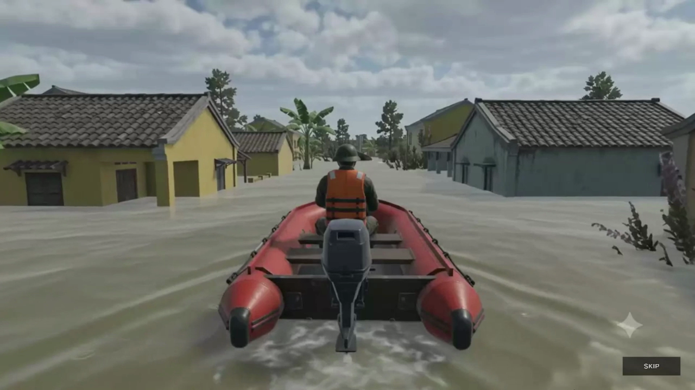
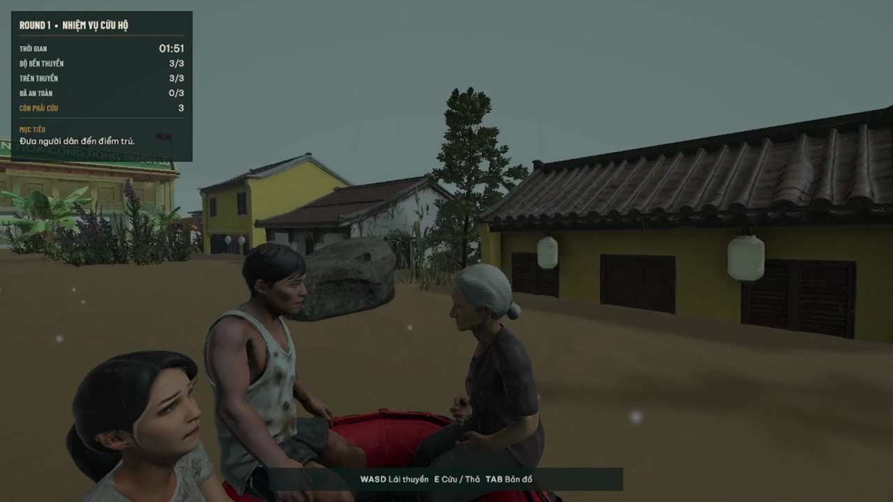
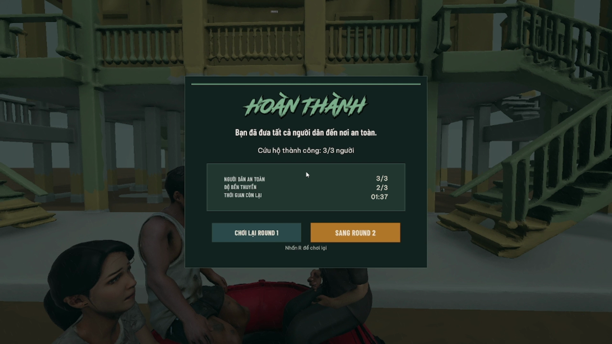

<div align="center">



# 🚣 Lộ Trình Cứu Trợ — Flood Route

**Lái xuồng cứu hộ xuyên vùng lũ miền Trung, đưa người dân về nơi an toàn trước khi hết giờ.**


[Giới thiệu](#-giới-thiệu) · [Cách chơi](#-cách-chơi) · [Tính năng](#-tính-năng) · [AI & Art](#-ai--art) · [Gallery](#-gallery) · [Chạy game](#-chạy-game) · [English](#-english-summary)

</div>

<!-- Kéo flood-route-demo-720p.mp4 vào ô soạn thảo README trên GitHub để nhúng video demo tại đây -->

---

## 🌊 Giới thiệu

**Lộ Trình Cứu Trợ (Flood Route)** là game 3D góc nhìn thứ nhất, lấy bối cảnh một xóm nhỏ ở miền Trung Việt Nam bị nước lũ nhấn chìm: mái ngói Hội An nhô lên khỏi mặt nước, người dân vẫy tay cầu cứu trên nóc nhà, và nhà văn hóa cộng đồng trên cột cao là nơi trú ẩn cuối cùng.

Bạn là người cầm lái xuồng cao su cứu hộ. Mỗi vòng chơi là một bài toán **lập lộ trình dưới áp lực thời gian**: cứu ai trước, đi đường nào, tránh rác trôi và chướng ngại, rồi quay về điểm an toàn.

## 🎮 Cách chơi

| Phím | Hành động |
|:---:|---|
| `W` `A` `S` `D` / ↑ ← ↓ → | Lái xuồng |
| `E` | Cứu người / thả người tại điểm an toàn |
| `TAB` | Mở bản đồ cứu hộ |
| `P` | Tạm dừng |
| `R` | Chơi lại vòng hiện tại |

**Luật cơ bản**

- Xuồng phải **chạy chậm** mới cứu được người. Lao nhanh vào nhà sẽ không nhận được tín hiệu cứu.
- Xuồng chở tối đa **3 người**, có **3 điểm độ bền**. Va chạm mạnh vào nhà, cây hoặc vật cản sẽ bị trừ độ bền.
- Hết giờ hoặc hỏng xuồng là thua.

| Vòng | Nhiệm vụ | Thời gian | Điểm nhấn |
|---|---|:---:|---|
| **Round 1** | Cứu 3 người dân quanh xóm | 3:00 | Làm quen lái xuồng, đọc bản đồ, cứu và thả người |
| **Round 2** | Cứu hộ thời gian thực | 3:30 | Nhiều điểm cứu hơn, rác trôi di chuyển cản đường |

## ✨ Tính năng

- 🛶 **Điều khiển xuồng có quán tính**: gia tốc, vệt nước, bọt sóng và phản ứng thân xuồng theo mặt nước.
- 🗺️ **Bản đồ cứu hộ** mở bằng `TAB` để đối chiếu vị trí xuồng, điểm cần cứu và điểm an toàn.
- 🧑‍🤝‍🧑 **Hệ thống hành khách**: người dân lên xuồng với tư thế ngồi riêng và gọi cứu bằng giọng Huế.
- 🌧️ **Không khí bão lũ**: mưa, mây giông trôi, nước lũ chuyển động, âm thanh môi trường ngẫu nhiên.
- 🏠 **Bối cảnh đậm chất Việt Nam**: nhà ngói vàng Hội An, nhà văn hóa cộng đồng tránh lũ, cây chuối.
- 🎬 **Luồng game hoàn chỉnh**: menu 3D, hướng dẫn, cutscene mở màn, briefing nhiệm vụ, màn hình kết thúc, menu tạm dừng.

## 🤖 AI & Art

Dự án này được làm **cùng AI** ở hầu hết các khâu, còn ý tưởng, thiết kế, tích hợp và đánh giá chất lượng là do mình quyết định.

| Khâu | Công cụ | Dùng để làm gì |
|---|---|---|
| Code | **Claude Code**, **Codex**, **ChatGPT** | Viết và refactor code Unity C#, soạn GDD, tài liệu thiết kế vòng chơi, audit dự án |
| Tự động hóa Unity | **Unity MCP** | Cho agent thao tác trực tiếp trong Unity Editor (dựng scene, gán component) |
| 3D | **Tripo** + Blender | Tạo mô hình nhà, xuồng, props rồi chỉnh sửa, đặt pivot, chuẩn hóa tỉ lệ |
| Ảnh / UI | **Gemini** | Concept, texture, thành phần giao diện |
| Nhạc & giọng nói | **Suno**, TTS | Nhạc nền *Flood Rescue - Rainy Hope*, *River Under Pressure* và giọng gọi cứu nam/nữ kiểu Huế |

Asset bên thứ ba: [NVJOB Water Shaders V2](https://nvjob.github.io/unity/nvjob-water-shaders-v2) cho mặt nước.

## 📸 Gallery

| | |
|:---:|:---:|
| <br>**Màn hình chính** | <br>**Cutscene mở màn** |
| <br>**Đưa người dân về nơi an toàn** | <br>**Hoàn thành nhiệm vụ** |

## 🧰 Tech stack

- **Engine:** Unity `6000.4.7f1`
- **Render pipeline:** Universal Render Pipeline (URP) 17.4
- **Input:** Input System 1.19
- **UI:** uGUI + TextMesh Pro (font Barlow Condensed, Be Vietnam Pro)
- **Ngôn ngữ:** C#
- **Khác:** Timeline, AI Navigation, NVJOB Water Shaders

## 🚀 Chạy game

1. Cài **Unity Hub** và editor **6000.4.7f1**.
2. Clone repo:
   ```bash
   git clone https://github.com/nhatanh-dev/flood-route.git
   ```
3. Mở thư mục vừa clone bằng Unity Hub (lần đầu import sẽ hơi lâu).
4. Mở scene `Assets/Scenes/MainMenu.unity` và bấm **Play**.

> Các scene cần thiết đã nằm sẵn trong Build Settings.

---

<a id="-english-summary"></a>

<details>
<summary><b>🇬🇧 English summary</b></summary>

### Flood Route

A first-person 3D rescue game set in a flooded village in Central Vietnam. You pilot an inflatable rescue boat, pick up stranded villagers from rooftops and deliver them to a community shelter before time runs out.

**Controls:** `WASD`/arrows to steer · `E` rescue/drop off · `TAB` rescue map · `P` pause · `R` restart round.

**Rules:** slow down to rescue anyone; the boat carries up to 3 people and has 3 durability points; hard collisions cost durability; running out of time or durability fails the round.

**Rounds:** Round 1 (3 villagers, 3:00) teaches steering, map reading and drop-off. Round 2 (3:30) adds more rescue points and drifting debris.

**Built with AI:** code with Claude Code, Codex and ChatGPT; Unity Editor automation via Unity MCP; 3D models with Tripo + Blender; images/UI with Gemini; music and voice lines with Suno and TTS. Design direction, integration and quality control by the author.

**Tech:** Unity 6000.4.7f1 · URP 17.4 · Input System · TextMesh Pro · NVJOB Water Shaders.

**Run:** install Unity 6000.4.7f1, clone the repo, open it in Unity Hub, open `Assets/Scenes/MainMenu.unity`, press Play.

</details>
